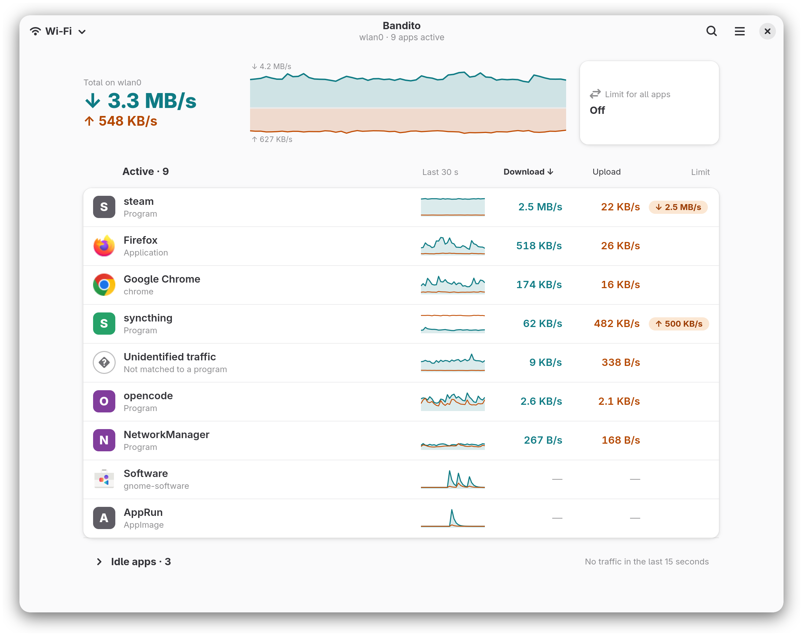

# Bandito GTK

A modern, GTK4-based bandwidth monitor and traffic shaper for Linux.

Bandito GTK allows you to monitor network traffic per application and apply
bandwidth limits (download and upload) using `eltrafico-tc` and `bandwhich` as
backends.




## Features

- **Real-time Monitoring:** Total download and upload with a one-minute chart,
  and a 30-second history for every app. Busy apps sort to the top; quiet ones
  fold into an Idle group.
- **Traffic Shaping:** Limit download and upload separately, per app or for all
  apps at once, from a side panel with presets. Every change can be undone.
- **Remembered Limits:** Limits are saved per app and applied again on start.
- **Connections:** Each app's panel lists the hosts it talked to in the last
  minute, with the service, port and rates. Traffic that can't be matched to a
  program is shown with its connections and the likely reasons.
- **Readable Units:** Rates and limits share one unit (KB/s and MB/s, or bits
  from the menu).
- **Modern UI:** Built with GTK4 and libadwaita, with real app names and icons
  from your installed applications.
- **Automatic Dependencies:** Automatically downloads and caches required
  binaries (`eltrafico-tc`, `bandwhich`) in your XDG cache directory.
- **Network Switching:** Pick the network on first run and switch from the
  header bar at any time.

## Installation

### Binary

You can download the latest pre-compiled binary from the
[Releases](https://github.com/sigmaSd/bandito-gtk/releases) page.

Once downloaded, make the binary executable:

```bash
chmod +x bandito-gtk
```

### Flatpak

You can install via Flatpak from the
[Releases](https://github.com/sigmaSd/bandito-gtk/releases) page (build-*
releases). Download the `.flatpak` file for your architecture and install:

```bash
flatpak install --user bandito-gtk-<arch>.flatpak
```

## Usage

Run the application:

```bash
./bandito-gtk
```

If no interface is specified as an argument, a selection window will appear. You
can also specify the interface directly:

```bash
./bandito-gtk wlan0
```

## Development

Requires [Deno](https://deno.land/).

```bash
deno run -A src/main.ts [interface]
```

To try the interface without root, downloads or network traffic, run it with
simulated data:

```bash
BANDITO_DEMO=1 deno run -A src/main.ts
```

Settings and saved limits live in `$XDG_CONFIG_HOME/bandito/settings.json`.

## Dependencies

The application relies on:

- `pkexec` (for root privileges when measuring and shaping traffic)
- `eltrafico-tc` 2.3.10 and `bandwhich` 0.23.1, downloaded automatically

Bandito downloads exact versions of the two helpers and checks their SHA-256
checksums. Before each run, a short root script copies the helper into
`/var/lib/bandito/helpers`, checks the copy and runs it, so a changed file in
`~/.cache/bandito` is never run as root. Because of this, the password prompt
names `/bin/sh`. To use your own builds, install them on your `PATH`, or set
`TC` and `BANDWHICH` to their paths; those are run as they are.

- GTK4 libraries
