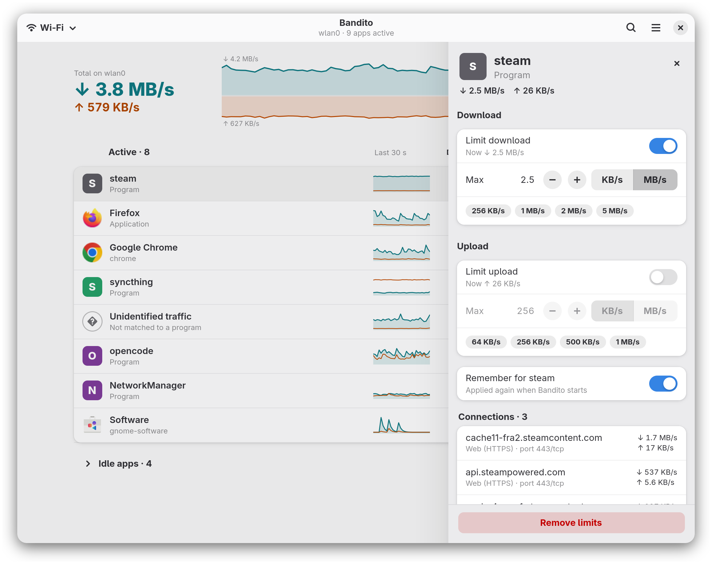
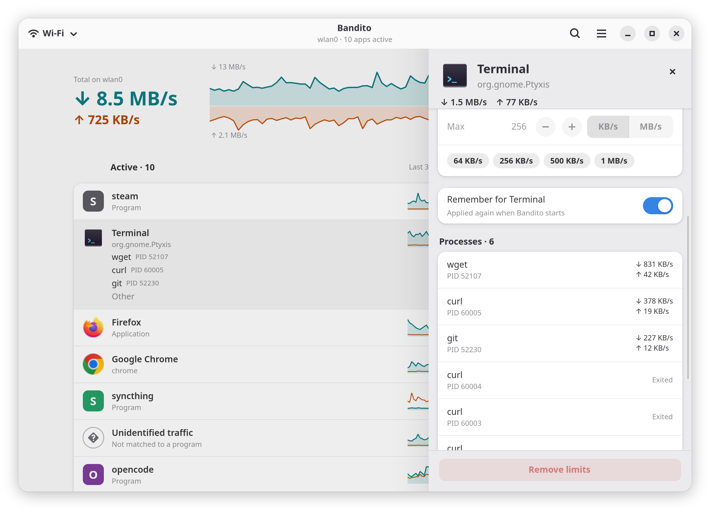

# Bandito GTK

A modern, GTK4-based bandwidth monitor and traffic shaper for Linux.

Bandito GTK allows you to monitor network traffic per application and apply
bandwidth limits (download and upload), over IPv4 and IPv6, with
[netleash](https://github.com/sigmaSd/netleash) as its eBPF backend.




## Features

- **Real-time Monitoring:** Total download and upload with a one-minute chart,
  and a 30-second history for every app. Busy apps sort to the top; quiet ones
  fold into an Idle group.
- **Traffic Shaping:** Limit download and upload separately, per app or for all
  apps at once, from a side panel with presets. Every change can be undone.
- **Remembered Limits:** Limits are saved per app and applied again on start.
- **Connections:** Each app's panel lists the hosts it talked to in the last
  minute, with the service, port and rates. Traffic that can't be matched to a
  program is shown with its connections and the likely reasons.
- **Processes:** When several processes in one app use the network, such as
  programs started from a terminal, each gets its own line under the app, and
  the app's panel lists them with their PIDs. Needs netleash 0.3.0 or later.

  

- **Readable Units:** Rates and limits share one unit (KB/s and MB/s, or bits
  from the menu).
- **Modern UI:** Built with GTK4 and libadwaita, with real app names and icons
  from your installed applications.
- **Automatic Setup:** Uses the netleash the `.rpm` or `.deb` installed, or
  downloads and checks a pinned one in your XDG cache directory, or uses yours
  if it has its capabilities.
- **Update Notice:** On start, Bandito asks GitHub whether a newer release is
  out and offers it in a banner. Turn it off with "Check for updates" in the
  main menu.
- **Network Switching:** Pick the network on first run and switch from the
  header bar at any time.

## Installation

### Fedora, Ubuntu and Debian

Download the `.rpm` or `.deb` for your machine from the
[latest release](https://github.com/sigmaSd/bandito-gtk/releases/latest) and
install it. The packages add Bandito to your app menu with its icon, and include
netleash, so nothing is downloaded when it starts. Administrators (`wheel` on
Fedora, `sudo` on Ubuntu and Debian) at the machine aren't asked for a password,
as with NetworkManager and firewalld; other users enter an administrator's
password, remembered for a few minutes. They need libadwaita 1.5: Fedora 40,
Ubuntu 24.04, Debian 13 or later.

```bash
sudo dnf install ./bandito-gtk-*.x86_64.rpm
sudo apt install ./bandito-gtk_*_amd64.deb
```

They don't update themselves: Bandito shows a banner when a new version is out.

### Binary

Download the binary for your machine, `bandito-gtk-x86_64` or
`bandito-gtk-aarch64`, from the
[latest release](https://github.com/sigmaSd/bandito-gtk/releases/latest), then
make it executable:

```bash
chmod +x bandito-gtk-x86_64
```

### Flatpak

You can install via Flatpak from the
[Releases](https://github.com/sigmaSd/bandito-gtk/releases) page (build-*
releases). Download the `.flatpak` file for your architecture and install:

```bash
flatpak install --user bandito-gtk-<arch>.flatpak
```

## Usage

Run the application:

```bash
./bandito-gtk-x86_64
```

If no interface is specified as an argument, a selection window will appear. You
can also specify the interface directly:

```bash
./bandito-gtk-x86_64 wlan0
```

## Development

Requires [Deno](https://deno.land/).

```bash
deno run -A src/main.ts [interface]
```

To try the interface without root, downloads or network traffic, run it with
simulated data:

```bash
BANDITO_DEMO=1 deno run -A src/main.ts
```

Settings and saved limits live in `$XDG_CONFIG_HOME/bandito/settings.json`.

## Dependencies

The application relies on:

- [netleash](https://github.com/sigmaSd/netleash), which measures and limits
  traffic with eBPF. Two ways to run it:
  - **As you, with no password prompt:** install netleash and give it its
    capabilities once. Bandito finds it on your `PATH`:

    ```sh
    cargo install netleash
    sudo setcap cap_bpf,cap_net_admin,cap_perfmon+ep ~/.cargo/bin/netleash
    ```

  - **Otherwise:** Bandito downloads a pinned netleash release (x86_64 or
    aarch64) and checks its SHA-256. When monitoring starts, `pkexec` asks for
    your password to run `/bin/sh -s netleash`: a short root script, sent on
    stdin, copies netleash into `/var/lib/bandito/helpers`, checks the copy and
    runs it. A changed file in `~/.cache/bandito` is never run as root.

  `NETLEASH` points Bandito at another netleash binary: run as you if it has the
  capabilities, otherwise through `pkexec` as it is.
- GTK4 libraries

## License

[MIT](LICENSE)
